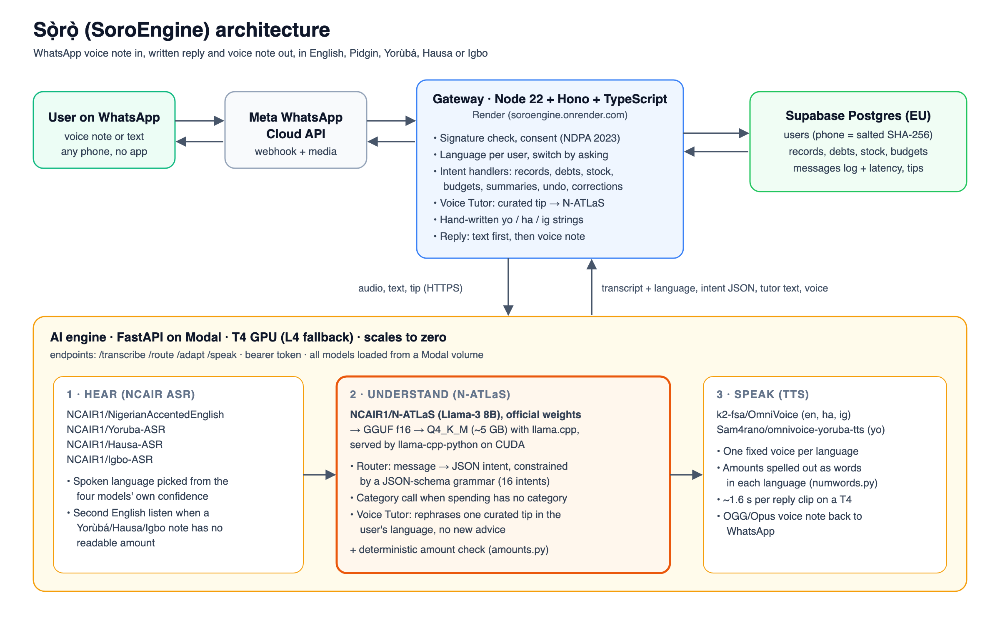

# N-ATLaS integration: Sọ̀rọ̀

- **Product:** Sọ̀rọ̀, a voice-first money assistant on WhatsApp for traders, artisans, workers and students in Nigeria
- **Company:** Charavol Technologies Ltd
- **Track:** Innovation & Enterprise · **Theme:** Voice-First Access
- **Try it:** https://soro.charavol.com · **Code:** https://github.com/d-beloved/soro



## 1. What Sọ̀rọ̀ does

A user sends a WhatsApp voice note such as *"Mo ta ìrẹsì àpò mẹ́ta, ẹgbẹ̀rún márùndínlọ́gọ́rin"* ("I sold three bags of rice for 75,000"). Sọ̀rọ̀ then:

1. Works out which language was spoken.
2. Understands what the note means.
3. Saves the record.
4. Replies with text and a voice note in the same language.

Users can:

- record sales, spending, income, debts, repayments and stock
- set budgets
- ask for a day, week or month summary
- undo or correct the last record
- ask money questions

It works in English, Nigerian Pidgin, Yorùbá, Hausa and Igbo, on any phone with WhatsApp. No app, no typing, and no reading are needed.

## 2. Where N-ATLaS sits

N-ATLaS is the **understanding layer** of every message. Everything Sọ̀rọ̀ does after hearing a note is decided by N-ATLaS's output.

| Step | Model | Role |
|---|---|---|
| Hear | NCAIR1 Whisper ASR ×4 (English, Yorùbá, Hausa, Igbo) | Speech to text, and spoken-language detection |
| **Understand** | **NCAIR1/N-ATLaS** | **Message → structured intent (router), spending category, Voice Tutor answers** |
| Speak | OmniVoice (en/ha/ig), OmniVoice Yorùbá fine-tune (yo) | Reply text to voice note |

All seven models are open models running on our own GPU. **No third-party LLM API is called.**

## 3. How we run N-ATLaS

### Weights
We start from the **official `NCAIR1/N-ATLaS` safetensors** on Hugging Face (Llama-3 8B base, fine-tuned by Awarri for Nigerian languages). Our setup script ([`engine/soro_engine/setup_models.py`](../engine/soro_engine/setup_models.py)) converts them ourselves:

1. `convert_hf_to_gguf.py` (llama.cpp) produces a GGUF in f16.
2. `llama_model_quantize` produces **Q4_K_M**, about 5 GB.

This fits an 8B model into the 16 GB of a T4 next to four ASR models and two TTS models.

### Serving
- **llama-cpp-python 0.3.36**, built with CUDA for T4 (sm_75) and L4 (sm_89). All layers are on the GPU.
- Context 6,144 tokens. Temperature 0.1 and repeat penalty 1.12, for stable, repeatable output.
- It is hosted on **Modal** as a FastAPI service. The GPU scales to zero when idle, so cost follows use.

## 4. The three jobs N-ATLaS does

### 4.1 Router: free speech to structured data
Every transcript, in any of the five languages, goes to N-ATLaS with a system prompt and 57 few-shot examples written in all five languages. The examples include ASR mistakes we have seen in real voice notes.

N-ATLaS must answer in JSON that matches a **JSON schema, enforced by a llama.cpp grammar**, so it cannot return malformed or off-list output. The schema has:

- **16 intents:** `log_sale`, `log_expense`, `log_income`, `log_debt`, `debt_paid`, `stock_update`, `summary_query`, `set_budget`, `undo_last`, `correct_last`, `loan_intake`, `ask_question`, `greeting`, `help`, `set_language`, `unknown`
- **Fields:** item, quantity, unit, amount (₦), counterparty, debt direction, period, category, tip topic, target language

Examples:

- Input: *"I sell three bags of rice seventy five thousand"*. Output:
  ```json
  {"intent": "log_sale", "item": "rice", "quantity": 3, "unit": "bags", "amount_ngn": 75000}
  ```
- Input: *"Mama Chidi owe me five thousand naira"*. Output:
  ```json
  {"intent": "log_debt", "counterparty": "Mama Chidi", "amount_ngn": 5000, "direction": "owed_to_me"}
  ```

When an expense comes back without a category, a second small N-ATLaS call picks one of 13 categories. That call also uses a constrained schema.

### 4.2 Voice Tutor: grounded money advice
When a user asks a money question (*"How I fit save money when market slow?"*):

1. The router tags it `ask_question` with a topic, for example `savings`.
2. The gateway picks one tip on that topic from **30 curated, reviewed tips**. The tips cover separating business and personal money, record keeping, cash flow, debt recovery, credit readiness, savings and pricing.
3. N-ATLaS answers **only from that tip**, in the user's language, in at most three short sentences. The answer is written to be spoken.

The system prompt forbids new facts, numbers, products, banks, apps and investment advice. N-ATLaS adapts trusted advice; it does not invent financial guidance. If the call fails, the stored hand-written translation of the tip is sent instead.

### 4.3 Safeguards around N-ATLaS
Money records must be exact, so we check N-ATLaS's output in code instead of trusting it blindly:

- **Deterministic amount check** ([`amounts.py`](../engine/soro_engine/amounts.py)). Every amount the router returns is matched against the amounts actually said in the message. The checker reads digits, "5k", English number words, and Yorùbá, Hausa and Igbo number words, including common ASR mis-hearings. If N-ATLaS gives a figure the message does not support, the figure is corrected. Amounts that were said but not recorded are flagged back to the user.
- **Lists as one record.** N-ATLaS is told to record "I buy meat 9,000, garri 1,000 and pepper 200" as one ₦10,200 expense. When it adds up only some of the amounts (₦9,200 here), the check keeps that figure and tells the user it also heard ₦1,000, so they can correct the record. Next, the check will use the full total when the record names every item.
- **English second listen.** Many people say amounts in English inside a Yorùbá, Hausa or Igbo sentence. If no amount can be read from the first transcript, the engine also runs the English ASR. N-ATLaS then sees both transcripts and uses the readable amount.
- **Field clean-up.** A field that does not belong to the intent is dropped. One example is a category on a sale.
- **Corrections and undo.** Users can say *"no, na 7,000"* or *"undo"*, so they can fix anything the model gets wrong.

## 5. Language handling with NCAIR models

- Each user has a saved language, and can change it by asking in any language (`set_language`).
- Voice notes are transcribed first with the user's own language model. If that model is not confident (log-probability below −0.35), the other three NCAIR models also transcribe the note. The reply switches language only if another model is clearly more confident (a margin of 0.25). Speakers can therefore change language from one message to the next.
- Pidgin is transcribed by `NCAIR1/NigerianAccentedEnglish` and understood by N-ATLaS directly. The router examples include Pidgin.
- Bot messages in Yorùbá, Hausa and Igbo are hand-written by us rather than machine-translated, so wording and tone marks are correct.

## 6. Engineering evidence

- **Tests:** 140 engine tests (Python/pytest) and 138 gateway tests (TypeScript/Vitest). They cover:
  - the router schema and the field clean-up
  - the few-shot examples, which must pass their own amount check
  - Yorùbá, Hausa and Igbo number parsing, with round-trip tests for every Yorùbá amount
  - the language switch and the English second listen
  - corrections and undo
- **Logging:** every message is logged with its intent, language, router output and end-to-end latency. Phone numbers are stored only as a salted hash. This log is the source of our interaction export (`npm run export:csv`).
- **Iteration from real use:** fixes came from real user voice notes. Examples include amounts spoken as lists, English amounts inside Yorùbá notes, and Yorùbá number forms read wrongly. Each fix was added as a test.

## 7. Privacy and compliance

- Under NDPA 2023, a user must give explicit consent before any data is stored.
- Phone numbers are stored only as a salted SHA-256 hash.
- The database is Supabase Postgres in the EU region.
- Users can anonymise their data at any time by sending `DELETE`.
- All model inference runs on our own GPU. No user audio or text is sent to a third-party AI API.

## 8. Licences and attribution

- **N-ATLaS** is an initiative of the Federal Ministry of Communications, Innovation and Digital Economy, powered by Awarri Technologies. We use it under the N-ATLaS licence. The free tier is capped at 1,000 active users per 30 days, and we will seek a commercial licence before going past that.
- **ASR:** NCAIR1/NigerianAccentedEnglish, Yoruba-ASR, Hausa-ASR and Igbo-ASR.
- **TTS:** k2-fsa/OmniVoice and Sam4rano/omnivoice-yoruba-tts, both Apache-2.0.
- **Inference:** llama.cpp and llama-cpp-python (MIT).

## 9. Scaling path

- Q4_K_M lets N-ATLaS share one 16 GB GPU with all six other models. One container serves the whole pipeline, and it scales to zero when idle.
- The gateway is stateless, so it can scale out on its own. The engine can raise `max_containers` as traffic grows.
- Next steps:
  - a smaller N-ATLaS quantisation for faster first replies
  - batching router calls
  - keeping a warm GPU during market hours
